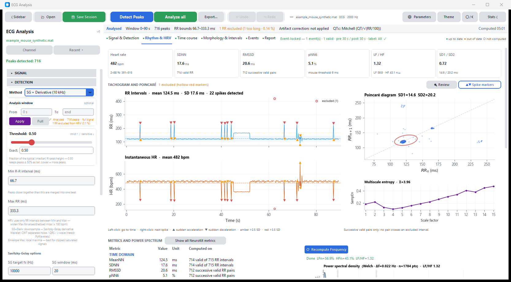
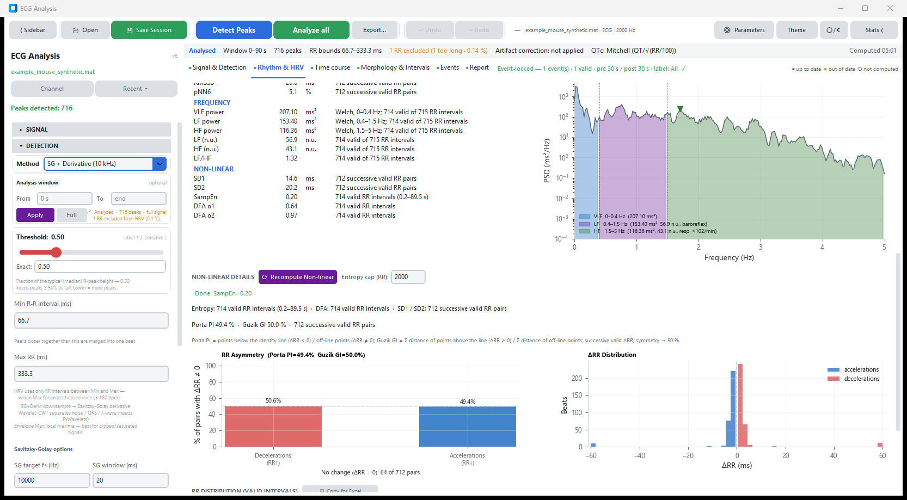
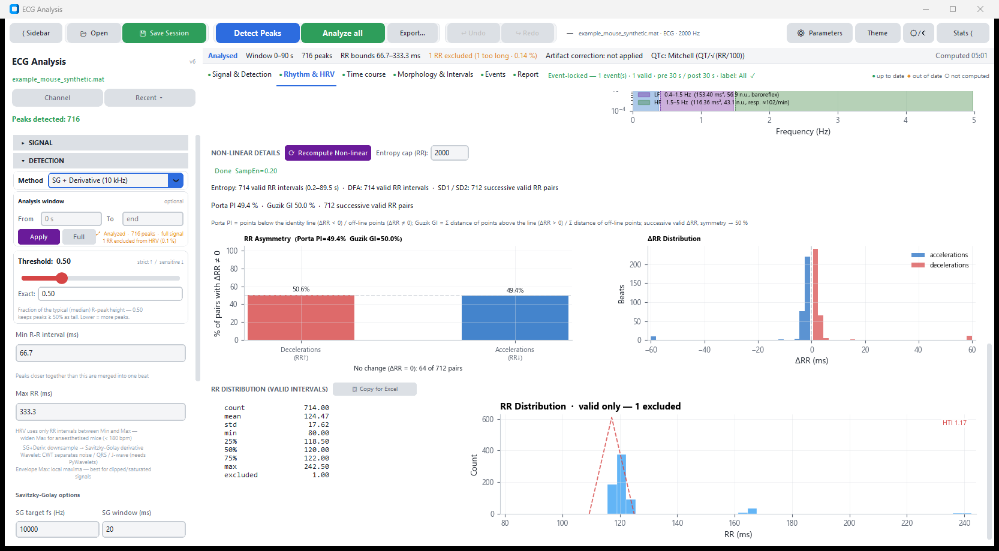
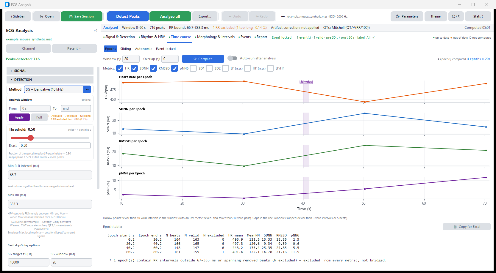
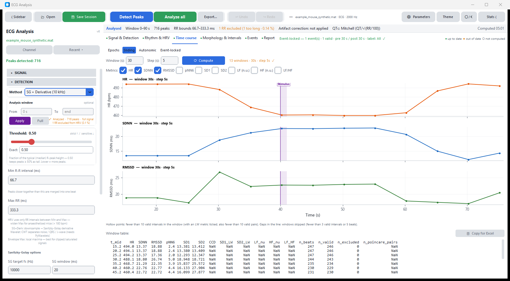
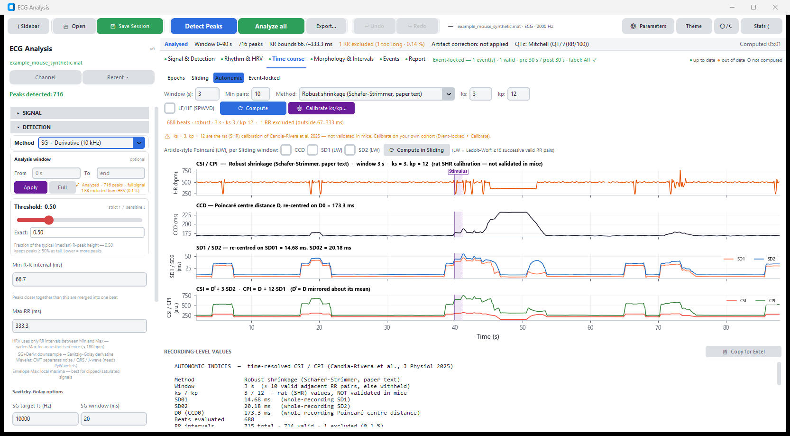
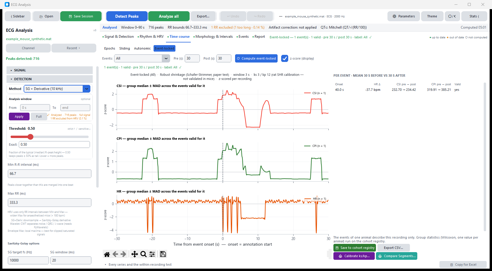
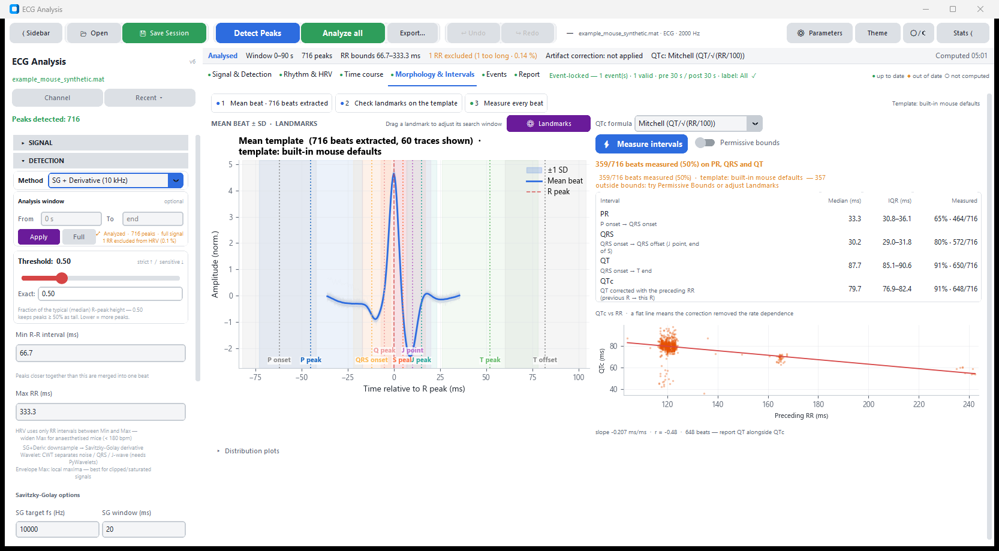
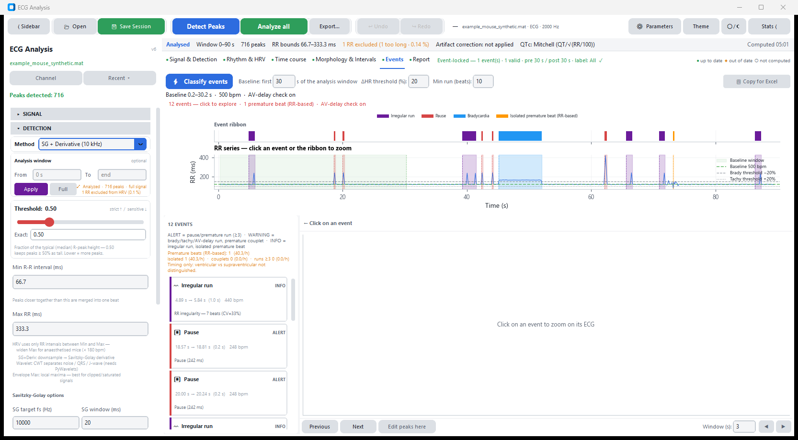
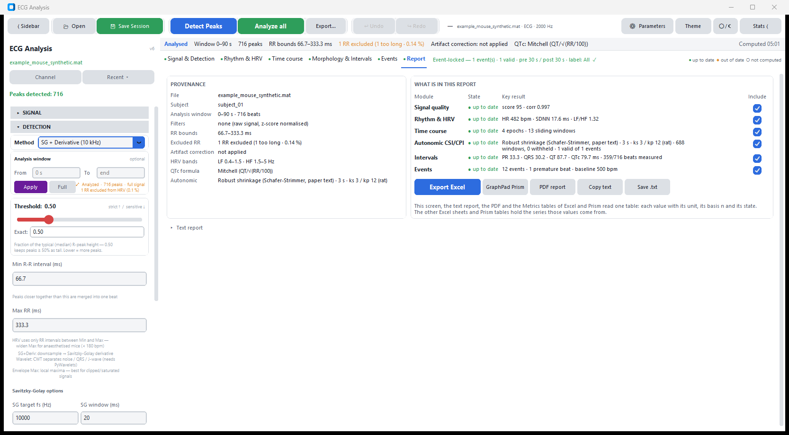

# User Guide — ECG Analysis (Mouse Cardiac Toolkit)

*This is a walkthrough of the desktop application itself — what each tab
does and how to move through a typical analysis. For the full feature
list, installation, and project architecture, see the main
[README](../README.md).*

All screenshots in this guide were captured against a synthetic demo
recording (90 s, ~500 bpm baseline with a deliberately inserted
bradycardia/pause episode and a short irregular run), generated purely to
have something realistic to show — not real experimental data. Your own
recordings will look different; the workflow is identical.

## Contents

1. [Launching the app](#launching-the-app)
2. [Loading a recording](#loading-a-recording)
3. [R-peak detection](#r-peak-detection)
4. [Reading the Detection view](#reading-the-detection-view)
5. [HRV analysis](#hrv-analysis)
6. [Autonomic indices (CSI / CPI) — Candia-Rivera et al. 2025](#autonomic-indices-csi--cpi--candia-rivera-et-al-2025)
7. [Interval delineation](#interval-delineation)
8. [Abnormal events](#abnormal-events)
9. [Report tab](#report-tab)
10. [Parameters & interpretation](#parameters--interpretation)
11. [Exporting & saving your work](#exporting--saving-your-work)
12. [Tips & troubleshooting](#tips--troubleshooting)

---

## Launching the app

```bash
python -m ecg          # preferred entry point
python ecg_app.py       # backward-compatible entry point
ecg-analysis            # after `pip install -e .`
```

The app has five analysis tabs and a report, organised by question:

| Tab | The question | Holds |
|-----|--------------|-------|
| **Signal & Detection** | Is the signal good and are the peaks right? | Signal, peak editing, quality panel |
| **Rhythm & HRV** | What are the rhythm and its variability over the window? | RR / HR, time domain, frequency, non-linear, RR asymmetry |
| **Time course** | How do they change over time? | Epochs, Sliding, Autonomic, Event-locked (one selector) |
| **Morphology & Intervals** | What does a beat look like and how long are its intervals? | Steps: mean beat, landmarks, intervals |
| **Events** | What happened that should not have? | Event ribbon, event list, ECG zoom |
| **Report** | What goes out? | Provenance, module states, Include, exports |

Above every tab, the **context strip** says what the numbers rest on (window,
peaks, RR bounds, exclusions, artifact correction, QTc formula). Each tab head
carries one state: ● up to date, ◆ out of date, ○ not computed; hover it for the
reason.

The window opens on the **Signal & Detection** tab with no file loaded. The
toolbar along the top (**Open**, **Save**, **Detect Peaks**, **Analyze**,
undo/redo, the signal-quality badge, and the theme toggle) stays visible
no matter which tab you're on — everything downstream of loading a file
starts from there.

---

## Loading a recording

Click **Open** and pick a MATLAB `.mat` file — legacy v5/v6 or v7.3/HDF5
(Spike2 exports), both are handled automatically, including channel and
sampling-rate detection. The left sidebar's **Signal** section shows the
detected channel name and sampling rate (editable if auto-detection
guesses wrong), and the **Filters** section controls whether detection
runs on the raw signal or a bandpass/notch/cleaned version — see
[Reading the Detection view](#reading-the-detection-view) for what that
choice does to the display.

Opening a file immediately shows the raw trace with no processing. Nothing
is filtered, detected, or analyzed until you click **Detect Peaks**.

---

## R-peak detection


Click **Detect Peaks** to run the selected detection method (**Method**
dropdown in the left sidebar — Auto/NeuroKit2, Savitzky-Golay + derivative,
continuous wavelet transform, envelope-max, or your own trained ML
detector) over the whole recording. The detail plot shows the signal for
the current time window, with accepted peaks marked in green and the
active amplitude threshold as a dashed red line — drag the **Threshold**
slider in the sidebar (or type an exact value) to tighten or loosen
detection without re-running the whole pipeline.


Use the navigation bar above the plot (◀◀ / ◀ / ▶ / ▶▶, or type a time and
click **Go**) to move through the recording, and the **Window** field to
widen or narrow how many seconds are visible at once. If a peak is
missed or a false one is added, **Edit Peaks** switches into manual
edit mode — click near a peak to remove it, or in empty space (with
**Free Placement** on) to add one — with full undo/redo.

The right-hand **Statistics** panel shows heart rate, RR intervals, HRV
(SDNN/RMSSD/pNN6), and a signal-quality score built from how closely
each beat matches the recording's own beat template. Excluding, adding,
or undoing a peak clears the HRV numbers immediately (they'd otherwise
be describing beats that no longer match what's on screen) — click
**Analyze** again to recompute them from the corrected peaks.

---

## Reading the Detection view

The detail plot always shows two traces, layered on top of each other:

- The **primary trace** (solid) — whichever of raw/filtered you have
  selected via the sidebar's "Show raw signal" toggle.
- A **ghost trace** (faint, 20% opacity) — the other one, so the effect
  of filtering is always visible even when you're focused on the raw
  view.

**Blue is raw, purple is filtered** — a fixed color convention across the
whole app, so you can tell at a glance which one you're looking at
without reading the label. Green dots are accepted peaks; a red dashed
line is the active detection threshold.


The screenshot above is zoomed into the demo recording's inserted
bradycardia episode — note the visibly wider spacing between peaks
compared to the baseline window shown earlier. This is exactly the kind
of thing the [Events](#abnormal-events) tab classifies
automatically across the whole recording, so you don't have to spot it
by scrolling through manually.

---

## HRV analysis

Click **Analyze all** in the header to compute heart-rate variability metrics. It
runs the core analysis and Frequency, then Non-linear in the background, then the
epochs when their auto-run is on; Intervals and Events keep their own buttons. While
Frequency and Non-linear are still running, Rhythm & HRV and the Report tab say
**computing**, and an export first asks whether to wait: if you go on, the Excel
Cover, the Prism notes, the PDF footer and the text report name what is missing.

**Rhythm & HRV** is one scrolling page. **Time course** holds Epochs, Sliding (the
former Rolling), Autonomic and Event-locked, under one selector; the last two have a
section of their own below.

### Rhythm & HRV: key values, tachogram and Poincaré



Six key values on top, then a tachogram of every RR interval and instantaneous
heart rate across the recording, with automatic spike detection (sudden acceleration/
deceleration) and click-to-navigate — click a point here and the
Signal & Detection tab jumps straight to that moment. The Poincaré scatter with its
SD1/SD2 ellipse sits next to it.

### Rhythm & HRV: metrics and spectrum



The metric table gives each value with its unit and what it was computed on.
**Show all NeuroKit metrics** adds the extra metrics (SDANN, TINN, HTI...) to the
table and opens the raw NeuroKit tables at the bottom of the page, one under the
other, each with its **Copy for Excel**. No protocol-specific reference-range status
markers are shown.

Next to the table, a Welch power spectral density plot with mouse-specific VLF/LF/HF band
shading (not the human 0.04–0.15/0.15–0.4 Hz convention).

The plotted spectrum **is** the one the numbers come from: the valid RR
intervals are resampled at 20 Hz (cubic spline on their true times), Welch's
method is applied (Hann window, 75 % overlap, ≈0.02 Hz resolution), and
VLF / LF / HF are the integrals of that curve over the shaded bands —
**absolute powers in ms²**. LFn / HFn are Task Force normalised units,
LF or HF / (LF + HF), shown ×100 as n.u.; LF/HF = LF / HF; the HF peak gives
the respiration estimate. Sliding and Compare Segments use the same
estimator. Earlier versions took VLF/LF/HF from a different, max-normalised
NeuroKit spectrum (arbitrary units, mislabelled n.u.) and LFn / HFn as a
share of a total power that included VLF and 5–20 Hz: re-run Frequency HRV
on older sessions. Until then such a result is labelled **legacy NeuroKit
spectrum** (VLF / LF / HF in arbitrary units, LFn / HFn as % of total
power) in the Frequency table, the Report, the PDF, the Excel Cover and
HRV_Frequency sheets and Prism, and the PSD title flags it. In the raw
**HRV_Frequency** sheet each header carries its unit — `HRV_LF (ms²)`,
`HRV_LFn (fraction of LF+HF)` (a fraction; ×100 gives the n.u. shown
elsewhere), `HRV_LFpeak (Hz)`.

### Rhythm & HRV: non-linear details, asymmetry and distribution



Sample entropy, DFA, and a multiscale entropy (MSEn) curve across coarse-graining
scales, then RR asymmetry and the distribution of the valid RR intervals.

Poincaré SD1/SD2, DFA α1/α2 and the asymmetry / fragmentation indices use
**every valid beat of the analysis window**. Only the slow entropy block
(SampEn, ApEn, FuzzyEn, MSE, CD, …) is capped for runtime, to **Entropy cap
(RR)** valid intervals (default 2000; 0 = no cap; a negative entry is
rejected and reset to 2000). The block used is the
contiguous stretch with the fewest excluded intervals, and its size and time
span are shown in the status line ("entropy from 2,000 of 9,000 RR
(100–340 s)"), on the MSE curve, in the text report and on the Excel Cover
sheet. Earlier versions silently computed every non-linear metric on the
first 1000 beats.

### Epochs (Time course)



Fixed-window HRV trends, with low-beat-count windows visually flagged so
a noisy stretch doesn't get read as a real physiological change. Annotations are
drawn on every panel.

Epochs and Sliding share their metrics, their low-confidence rule (hollow points) and
their layout, but keep two separate compute loops: the mockup's "same engine" is not
done, because merging them would change values (a window with a single successive
pair gives a different RMSSD in each, see
`tests/ui/test_epoch_sliding_characterisation.py`).

### Sliding (Time course)



Sliding-window HRV trends with a results table under the plot —
useful for watching a metric drift continuously rather than in discrete
epochs. The **Article-style Poincare** options, ticked in the Autonomic mode and
computed here, add time-resolved CCD,
SD1 and SD2 using Ledoit–Wolf shrinkage covariance. Set **Window** to 3 s
and **Step** to 1 s to explore the temporal scale used in the rat study;
also compare longer windows, because a 3 s mouse window can contain too
few RR pairs at lower heart rates. Values are only reported when at least
10 consecutive, physiologically valid RR pairs are available in a window.
These Ledoit–Wolf measurements are not the article's CSI / CPI indices and
should not be read as sympathetic or parasympathetic measurements; for the
article's method (one window per beat, CSI / CPI), use the **Autonomic**
mode — see
[Autonomic indices](#autonomic-indices-csi--cpi--candia-rivera-et-al-2025).

### One definition per metric

- **Mean HR** = 60000 / mean NN in every view and export. HR SD and
  min / max HR describe the instantaneous HR 60000 / RRᵢ: the sample SD
  (n − 1) and the **2nd / 98th percentiles** (robust to a stray missed or
  extra beat), identical in the Report, KPI bar, Excel ("HR range") and
  Compare Segments. (Earlier versions sometimes averaged the instantaneous
  HR, which reads 0.1–1 bpm higher; Compare Segments showed the absolute
  min / max and the earlier report a population SD.) When an older session is
  restored, its mean HR, HR SD and range are recomputed from the saved
  valid RR intervals, and the status bar says so.
- **Poincaré SD1 / SD2** = SD of (RRᵢ − RRᵢ₊₁)/√2 and of (RRᵢ + RRᵢ₊₁)/√2
  over successive pairs of adjacent valid intervals — the same function in
  Non-linear, Sliding, Compare Segments and the Report. **SD1 LW / SD2 LW**
  (Sliding) and the Autonomic methods are named variants with other
  covariance estimators.

### Compare Segments (Ctrl+M)

Opens from Ctrl+M or from **⚖ Compare Segments…** in Time course > Event-locked.

Pick two time ranges (or fill them around an event) and click **▶ Compare**:
the table shows every metric for both segments, with the same definitions
as the main panels. Each segment is also cut into **non-overlapping blocks**
of **Block (s)** seconds (default 10 s; a block is used when valid RR
intervals cover at least half of it) and the summary line gives the HR block
mean ± SD, the number of blocks and the B − A difference. A Mann-Whitney p on
the block means is shown as **descriptive only** (≥ 3 blocks per segment).
Two stretches of one recording are not independent samples — the
experimental unit is the animal — so do not report this p as a group
effect: compare per-animal values across animals with the Event-locked
statistics / cohort tools. The Excel export adds a **Blocks** sheet (one row
per block) and the note. Earlier versions ran a Mann-Whitney U test on the
beat-level RR intervals (hundreds of autocorrelated values), which made
almost any two segments "significant".

---

## Autonomic indices (CSI / CPI) — Candia-Rivera et al. 2025



**Time course > Autonomic** computes time-resolved cardiac sympathetic (CSI) and
parasympathetic (CPI) indices after Candia-Rivera et al., J Physiol 2025
([doi:10.1113/JP288400](https://doi.org/10.1113/JP288400)), following the
authors' MATLAB code
([github.com/diegocandiar/robust_hrv](https://github.com/diegocandiar/robust_hrv)).
It needs only the detected peaks — Analyze is not required — and uses the
analysis window, the sidebar **Min / Max RR** bounds and the beats removed
by artifact correction, like every other HRV view. The result records the
analysis window it was computed on: after you change the window, the
status line turns orange ("computed on the analysis window …, now …") until
you press **⟳ Compute** again, and so does a change of the entries (e.g. ks /
kp written by the calibration dialog) that is not applied yet.

### What is computed

For every beat, a sliding Poincaré window of **Window (s)** (3 s, the
paper's rat value) holds the RR intervals that ended in the last *T*
seconds. Its successive pairs give **SD1** / **SD2** (square roots of the
eigenvalues of their covariance) and **D** (CCD — the distance of the
ellipse centre to the origin), time-stamped at the window's median time.
The whole-recording SD01 / SD02 / D0 re-centre the series, which are
resampled at 20 Hz, and

- **CSI = D̃ + ks · SD2** — D̃ is D mirrored about its mean, so a shorter
  cycle raises CSI;
- **CPI = D + kp · SD1** — a longer cycle raises CPI.

(The paper's printed equations put the mirrored D on CPI; its code mirrors
it for CSI, as the physiology requires — the app follows the code.)

Excluded RR intervals (outside the bounds, or spanning a removed beat) are
never bridged: Poincaré pairs never straddle them, and a window with fewer
than **Min pairs** valid adjacent pairs (10 by default) is withheld — blank,
and shaded grey on the plot. That floor is the app's addition: the
reference code computes every window, and **Min pairs = 2** reproduces it.
At 3 s, a window holds 10 pairs only above ~200 bpm: for bradycardic or
anaesthetised mice, lower Min pairs or lengthen the window.

### Choosing the covariance method

The **Method** dropdown sets how SD1 / SD2 (and D) are estimated:

- **Robust shrinkage** (default) — Schäfer & Strimmer (2005) shrinkage
  (`robustCovHRV.m`: variances toward their median, correlation toward 0),
  5 % trimmed-mean D. This is what the paper **text** says was used.
- **Rat reference code** — plain covariance with 5 % trimmed-mean D. This
  is what the published rat function `compute_CSI_CVI_rat.m` actually runs
  (its call to the robust estimator is commented out). The paper and its
  code therefore disagree; both are offered and the one used is recorded
  with every result and export.
- **Exact** / **Approximate** — the two other variants of
  `compute_rCSI_rCVI_type.m` (plain covariance; closed-form SD1 / SD2).
- **Ledoit–Wolf** — sklearn shrinkage toward a scaled identity, the
  estimator of Sliding's SD1 (LW) / SD2 (LW); for comparison
  only. Relative to the exact covariance it typically raises SD1 by 3–12 %
  and lowers SD2 by 4–10 % on 25–35-pair windows (data-dependent; it can
  lower SD1 in some windows). The robust shrinkage rounds the ellipse
  less (SD1 +4 to +7 %, SD2 −1 to −5 % on ~25-pair synthetic mouse
  windows) and in every window raises SD1 and lowers SD2.

### The ks / kp caveat

**ks = 3 and kp = 12 are the paper's rat (SHR) values** — rest vs
dobutamine, chosen at the inflection point of the paired Wilcoxon Z over
k = 1–20 and checked on WKY rats. **They are not validated in mice.** The
orange note under the controls, the plot title, the recording-level table
and every export (Excel Cover sheet, Prism notes, PDF header) say so.
Calibrate them on your cohort (see *Calibrating ks / kp* below).

### LF / HF (SPWVD)

Tick **LF/HF (SPWVD)** before **⟳ Compute** to add a fifth panel with
time-resolved LF and HF power from the smoothed pseudo Wigner–Ville
distribution (a port of `compute_PWVD.m`, Orini et al. 2012 kernel): RR
spline-resampled at 20 Hz, LF / HF summed over the HRV band preset (mouse
default LF 0.4–1.5 Hz, HF 1.5–5 Hz; the paper's rat bands were 0.1–1 /
1–3.5 Hz). The kernel constants ν₀ = 0.03, τ₀ = 0.06, λ = 0.3 are the ones
hard-coded in `compute_PWVD.m` — the toolbox's only set (its file defaults
are Frr = 4 Hz and the human bands); the paper applied them at 20 Hz to
rats. They are defined in normalised units, so their extent in seconds
and Hz depends on the 20 Hz resampling and the 4096 bins; they are not
validated in mice. It runs in overlapping chunks (120 s cores, 60 s
margins; about 40 s per hour of recording; 30 s post / pre ratios within
~0.1–1 % of a single pass). The power is unnormalised (a.u.) — compare it
within a recording, not with the Frequency view's Welch powers. RR gaps
longer than 2 s split the series: each stretch between them is computed as
its own series (the reference code bridges everything), the gaps are
blank, and so are stretches shorter than 10 s (two periods of the 0.4 Hz
LF floor, the ~12 s lag kernel). Shorter gaps are bridged; if they cover
more than 5 % of the time, LF / HF is not computed (the status says why)
and CSI / CPI are still shown.

### Event-locked workflow



Choose **Event-locked** in the selector of Time course.

1. **Mark the events.** Add one annotation per condition change (injection,
   stimulus…) in **Annotations**; its **start** time is the event onset.
   Give events of the same kind the same label.
2. **Compute the Autonomic indices** (⟳ Compute in the bar above).
3. **Choose the events and windows.** **Events** = *All*, one label, or
   *(unlabelled)*; **Pre** / **Post** = the windows before and after each
   onset (30 s / 30 s, as in the paper).
4. **⟳ Compute event-locked.** The plot shows CSI, CPI, HR (and LF / HF)
   around the onset (vertical line at 0): the bold line is the median
   across this recording's events, the shaded band ± the median absolute
   deviation, the faint lines the individual events. **z-score (display)**
   normalises each series by its whole-recording mean and SD, as in the
   paper's figures; it changes the plot only. The table beside it gives, per
   event, the onset, HR Δ, CSI and CPI pre → post and whether it is valid.
   **Every series and the within-recording test** opens the full list: pre, post
   and delta for HR, D, SD1, SD2, CSI, CPI (and LF / HF), and the Wilcoxon;
   **📋 Copy for Excel** copies one row per event. An
   event is **valid** when **no other annotation starts inside its pre or
   post window or at its onset** (the paper's minimum duration per
   condition; every annotation counts, also those the Events filter leaves
   out), and both windows lie inside the CSI / CPI series and are at least
   80 % covered by computed windows. **Events closer than Pre / Post to
   another event are INVALID** — successive doses would otherwise
   contaminate each other's baseline and response — and so are events too
   close to the start or end of the recording or over withheld stretches;
   the table says why, and invalid events are left out. HR and LF / HF are
   judged on their own coverage.
5. **Read the within-recording Wilcoxon with care.** It compares pre vs
   post over the events of *this* recording only: the events of one animal
   are repeated measures of that animal, so its p-values are descriptive,
   not population inference. **p** is the test's p (exact for small
   samples), **p(z)** the normal p of the z shown (MATLAB `signrank`'s
   approximate p); near 0.05 they can disagree.
6. **💾 Save to cohort registry.** Fill in the sidebar **Subject ID** and
   **Project name** first: they are stored with every event, together with
   the method, window, ks, kp and pre / post windows. **Set the Subject ID
   for each animal**: the sidebar keeps its value from one file to the
   next, and the per-subject calibration counts every recording filed
   under one ID as one animal. The status turns orange when the ID looks
   like the untouched default (`subject_01`) or when another recording of
   the project is already saved under it. Saving with the *All* filter
   replaces this recording's previously saved events of the same method
   and window (so a deleted annotation does not linger); saving one label
   only adds or updates that label's events. The status bar confirms how
   many events were written. **Export CSV…** saves the same rows to a
   file.

Changing the annotations, the peaks or the Autonomic parameters drops the
event-locked result (the panel says why); compute it again.

### Calibrating ks / kp

Once several animals are in the registry, click **⚖ Calibrate ks/kp…**:

1. Filter by **Label** (the contrast to calibrate on, e.g. the drug) and
   **Project** (pre-filled with the current project; empty = all), then
   choose the **Configuration** (method · window) — events computed with
   different methods or windows are never mixed. The dialog opens on the
   label with the most events: one condition contrast, as the paper's
   rest vs dobutamine. **All labels** pools different contrasts (vehicle
   and drug, two drugs) into one pre / post pair per animal; the dialog
   says so and Apply asks for confirmation.
2. Keep **Per subject mean** (default): each animal's events are averaged
   first, so an animal with five injections does not weigh five times —
   testing events as independent samples is pseudo-replication. Events
   without a Subject ID are treated as one subject per recording, and
   recordings sharing a default-looking ID are flagged. **Per event**
   reproduces the paper's procedure (it computed Z over trials: 41 SHR
   trials); per subject mean is this app's stricter default. The counts
   line shows n events, n subjects and n recordings.
3. Read the two **Z(k)** curves (k = 1–20): the paired Wilcoxon Z of
   post vs pre for CSI (−ΔD + ks·ΔSD2) and CPI (ΔD + kp·ΔSD1). Because the
   indices are linear in k, these come straight from the stored deltas of
   D, SD1 and SD2 — no recording is reprocessed. The paper's rule is the
   **inflection point** from which Z plateaus; the star marks a knee
   computed as an objective proxy (Kneedle on Z after its last sign
   change). Check that it sits where the curve flattens; dotted grey lines
   mark the rat values, dashed blue lines the current gains, dotted
   horizontal lines |Z| = 1.96 and dash-dot lines the Wilcoxon ceiling.
   Three things to watch, all spelled out under the curves:
   - **The ceiling.** Z is a rank statistic: it moves in discrete steps and
     cannot exceed a ceiling set by the number of units (2.20 for 6,
     2.52 for 8, 3.06 for 12). On that ceiling every animal changes the
     same way and Z cannot rank the gains; no knee is offered when the
     curve moves by fewer than 3 rank steps.
   - **A sign change.** When the heart-rate and HRV terms move in opposite
     directions, Z(k) changes sign: the index shows one direction at small
     k and the opposite at large k (the reversed stretch is shaded). A knee
     on the reversed stretch is marked ⚠ — choose the gain by the
     direction the physiology predicts (a sympathomimetic should raise
     CSI).
   - **In-sample tests.** The tests at gains chosen on these same events
     are optimistic (choosing k among 20 values is a selection the ×2
     Bonferroni does not correct; the paper validated its gains on another
     strain). They are marked *in-sample*: calibrate on one project or
     label, then select another to test at those gains.
4. The table gives, **at the current gains**, the paired Wilcoxon of CSI
   and CPI: n, median ± MAD before and after, z, p, p(z) and p
   Bonferroni-corrected for the two indices. With fewer than 6 subjects
   the exact two-sided p cannot reach 0.05.
5. **Apply ks = …, kp = …** writes the knee values into the Autonomic
   view's ks / kp entries (a gain with no knee is kept); it first asks for
   confirmation when a knee lies on a reversed stretch or labels are
   pooled. **It does not recompute anything**: press **⟳ Compute**, then
   **⟳ Compute event-locked**, to see the indices with the new gains (until
   then the Autonomic status says the entries differ from the displayed
   result). Report the gains together with the cohort they were calibrated
   on.

**Copy results** puts the test table on the clipboard; **Export cohort
CSV…** writes the filtered registry rows.

### Exports

With an Autonomic result, **Export Excel** adds the **Autonomic** sheet
(beat-wise SD1 / SD2 / CCD windows, recording-level SD01 / SD02 / D0 and
every parameter), **Autonomic_Series** (20 Hz CSI / CPI / HR / D / SD1 /
SD2), **Autonomic_LFHF** and **EventLocked**; **Export Prism** adds CSI /
CPI, D / SD1 / SD2, LF / HF and per-event pre / post tables; the figure and
ZIP exports include the Autonomic and Event-locked plots. The Excel Cover
sheet, the Prism project notes and the PDF report header state the method,
window, ks / kp and the rat-calibration caveat, and the span the indices
cover (first / last R peak and analysis window) — flagged when it is not
the window of the core HRV results in the same file. Since the Autonomic
view needs only the peaks, **Export Excel** also works before Analyze: it
then writes the Autonomic results alone (a Cover sheet saying the core HRV
was not computed, and the Autonomic sheets). The ZIP, Prism, PDF and
figure exports need Analyze.

### References

- Candia-Rivera D. et al. (2025). Modelling the time-resolved modulations
  of cardiac activity in rats: a study on pharmacological autonomic
  stimulation. *J Physiol*. [doi:10.1113/JP288400](https://doi.org/10.1113/JP288400)
- Candia-Rivera D., de Vico Fallani F., Chavez M. (2025). Robust and
  time-resolved estimation of cardiac sympathetic and parasympathetic
  indices. *R Soc Open Sci* 12:240750.
  [doi:10.1098/rsos.240750](https://doi.org/10.1098/rsos.240750)
- Code: [github.com/diegocandiar/robust_hrv](https://github.com/diegocandiar/robust_hrv)
- Schäfer J., Strimmer K. (2005). A shrinkage approach to large-scale
  covariance matrix estimation and implications for functional genomics.
  *Stat Appl Genet Mol Biol* 4:32.
- Orini M. et al. (2012). Characterization of dynamic interactions between
  cardiovascular signals by time-frequency coherence. *IEEE Trans Biomed
  Eng* 59(3):663–673.

---

## Interval delineation



The tab goes in three steps; the chip of the step you are on has a blue border.

1. **Mean beat**, from Analyze all.
2. **Check landmarks on the template.** Drag a landmark on the mean beat: its line
   moves the centre of its search window, a window edge resizes it. The change goes to
   this recording's template, as in the **⚙ Landmarks** dialog (which adds Auto-calibrate,
   Refine from delineation and template files). After a drag, the moved landmark is in
   colour and a grey line shows where it was for the intervals on screen; those stay
   as measured, and step 3 turns out of date, until you measure again. Nothing records
   that you checked: this step stays current until the beats are measured.
3. **Measure every beat.**

Click **Measure intervals** to locate P/Q/R/S/J/T landmarks, the QRS onset
and the QRS offset (J point) on every beat and compute PR/QRS/QT/QTc
intervals with the standard definitions:

- **PR** = P onset → QRS onset;
- **QRS** = QRS onset → QRS offset (J point, end of the S wave);
- **QT** = QRS onset → T end;
- **QTc** = QT corrected with the **preceding** RR (previous R → this R).

QRS onset is the first departure from the PR-segment baseline (Q-wave onset,
or the R upstroke when there is no Q); the J point is where the S wave returns
to that baseline. The mouse J wave that follows is early repolarisation
(Boukens et al. 2014), so it belongs to QT, not QRS. The PR baseline is the
last flat stretch the detector finds on each beat before the Q/R, so a widened
QRS (e.g. after a drug) is measured in full. QRS onset, J point and T end are
each placed where a least-squares line through the middle (30–70 %) of the
wave edge meets that baseline (a Q or S wave counts as the initial / terminal
QRS deflection once it dips more than 2 % of R, or 3× the PR-segment noise,
below the baseline; the R wave uses 5 %). P onset is placed the same way on
the P-wave upstroke, searched up to 30 ms before the P peak (when a P riding
on the previous T never returns to the baseline, the part of the upstroke
above the T–P junction is used, and the onset is not placed before that
junction). The P peak is searched after the previous beat's T peak and
measured against the PR baseline, so at 500–700 bpm the previous T wave is
not taken for this beat's P (PR read ~60 ms instead of 42 at 500 bpm before,
with false "Sustained PR prolongation" events); a beat without a P wave
above 3× the noise gets no PR. The mouse T-wave end is gradual: check where
**T offset** lands on the mean beat. Each beat is delineated in its own
window — up to ±100 ms, at most 70 % of its preceding RR before R and of its
following RR after R (a neighbour closer than Min RR is ignored) — so a
premature beat only affects itself and its neighbours; the exports and the
text report give the number of beats whose window was shortened (row
**Beat window**). QTc uses the preceding RR only when it is inside the Min /
Max RR bounds set for HRV. Both QRS landmarks appear in
**Landmarks** (Morphology & Intervals tab) as "QRS onset" and "J point" for display;
neither they nor the P onset and T end are clamped to the template windows. A landmark
that cannot be placed inside the beat window is left empty (the beat gets no
PR/QRS/QT) rather than being set to a window edge, and a template
auto-updated by one recording no longer shortens the next recording's QRS or
QT. This version also fixed: a beat window sized from the recording's
shortest RR (one premature beat removed QT from every beat and cut PR; at
~500 bpm the T end fell outside it), a P onset capped ~9 ms before the P peak
by the default template (PR 3–6 ms short with a 12–15 ms P upstroke; long PRs
were truncated to plausible values and are now measured, or rejected beyond
80 ms), Q waves of 2–5 % of R being skipped (QRS onset ~3 ms late), and QTc
empty for RRs above 333 ms even with a widened Max RR. It removed a
noise-dependent shortening of QT (several ms at
2–4 kHz) and of QRS, and QRS onsets before −22 ms or T ends before 60 ms after
R are no longer reported at those default-window limits. Earlier versions
measured PR to the Q nadir, QRS between the Q and S nadirs and QT from the R
peak (QRS and QT were shorter than in the literature) and corrected QT with
the following RR; a session saved by those versions is shown as **legacy** in
this tab and in the exports until you click **Measure intervals** again (its
QTc is re-paired with the preceding RR, or left empty — and stated so — when
the saved table has no R-peak times). The
line under the plots states which definitions the numbers use.

**Wave template (per recording).** The search windows that guide the
landmark detection belong to the recording. A newly opened recording starts
from the saved default template, or the built-in mouse defaults when none
was saved. Change it in **Landmarks** (Morphology & Intervals tab): drag lines or
window edges, **Auto-calibrate** on the mean beat, **Refine from
delineation** (centres the P/Q/S/T windows on this recording's measured
landmarks, after a first Measure intervals run), **Load…** a template file,
then **Apply to this recording** — this writes nothing to disk and the
template is saved with the recording's session. **Save as default
template** is the only action that changes the default for recordings opened
later (recordings already analysed keep their own template); **Save to
file…** writes a named template you can load on other recordings. Delineation
itself never changes or saves a template, so a recording gives the same
intervals whatever was analysed before it. Another channel of the same file
counts as another recording (often another animal): Detect Peaks on a
different channel drops the template made on the previous channel (the status
line says so) and the new channel starts from the saved default. The
template's provenance (built-in
defaults / saved default template / loaded from *file* / auto-calibrated,
refined or edited on this recording) is shown next to **Landmarks**, in the
Intervals status line, and as the "Wave template" row of the text report,
the Excel Cover sheet and the Prism notes, with the window centres. Earlier
versions narrowed the template to each recording after every run and re-saved
it as the default; a default written that way ("auto-updated") is ignored in
favour of the built-in defaults, and intervals computed by those versions show
"Wave template: not recorded".

Under the QT violin, **beat-to-beat IQR · range** is the spread of QT across
the beats of this single lead. It is **not** classical QT dispersion (an
inter-lead measure of one beat) — earlier versions called it "dispersion";
report the IQR, as the range is dominated by delineation outliers. The
text report, the Excel Cover sheet and the Prism notes carry the same
"Interval definitions" and "QT variability" rows, and the PDF report a QT IQR
row and a definitions footer. The panel on the left is a beat
verifier — step through individual beats (or the ensemble average) and
correct the template if the automatic landmark placement looks wrong
before trusting the QT/QTc numbers. The **QTc formula** dropdown switches
between (RR in ms):

- **Mitchell** (default, mouse-calibrated) — QTc = QT / √(RR / 100), Bazett
  normalised to a 100 ms mouse RR;
- **Bazett** (human) — QTc = QT / √(RR / 1000);
- **Fridericia** (human) — QTc = QT / ∛(RR / 1000).

Bazett and Fridericia are calibrated for a 1 s human RR and inflate QTc
~2–3.5× at mouse heart rates — use them only to compare with studies that
report them. The distribution plots on the right update immediately; check
the **QTc–RR** panel (a well-corrected QTc shows no slope against RR) rather
than trusting one formula's number blindly. Because the QT–RR relation is
weak in mice, always report the **uncorrected QT** alongside QTc. The formula
in use is recorded in the Excel, Prism and PDF exports, and saved with the
session.

---

## Abnormal events



Click **Classify events** to detect bradycardia/tachycardia runs, pauses,
premature beats (isolated, couplets and runs — RR-based, see below),
irregular-rhythm runs, and AV conduction-delay
episodes — all measured against this recording's own baseline heart
rate, not a fixed cutoff. The color-coded ribbon at the top gives an
at-a-glance view of where events cluster; each card on the left is one
episode. Click a card (or a ribbon segment) to zoom the RR-series plot
straight to that episode — in the screenshot above, the demo recording's
inserted bradycardia, pause, and irregular run were all found and are
listed with their exact timing and severity.

The baseline is always the first N seconds of the analysis window. The mockup's
second choice, "30 s before an annotation", is **not available**: it would be a new
calculation, left out of this redesign, which changes no number.

**Baseline**, **ΔHR threshold (%)**, and **Min run (beats)** at
the top control sensitivity — widen the baseline window or loosen the
threshold if real events are being missed, or tighten them if normal
variability is being over-flagged.

### Premature beats (RR-based)

A beat is **premature** when the RR interval it ends is shorter than 70 %
of the reference RR: the median of the 10 intervals before the group of
premature beats or, if smaller, of the 10 from the interval the rhythm
returns on — so a run must be shorter than the rhythm on both sides of
it. The group must end (rhythm back above that bound) within **30
beats**: a longer stretch of short intervals is a rate change, left to
the tachycardia rule, and a group still under way at the end of the
analysed window is not counted. Earlier versions compared each interval
with the median of its 10 neighbours, which a run of 6 or more beats
pulled down itself: such runs were never reported (they appeared as
irregular runs or tachycardia). They are now counted. A stretch of
normal (1:1) conduction between two 2:1-blocked stretches has the same
timing as a run and is reported as one — look at the bradycardia events
around it. This uses R-R
timing only: it **cannot distinguish ventricular from supraventricular**
premature beats — check the morphology on the ECG strip (click the card)
before calling one ventricular. Earlier versions labelled these "ESV"
(ventricular extrasystoles) and only reported runs of three or more.

Consecutive premature beats are grouped and each group is one event:
**isolated premature beat** (1, INFO), **premature couplet** (2,
WARNING) and **premature run ≥3** (ALERT). The header of the event list
and the action-bar status give the counts and **per-hour rates** — per
hour of the analysed span (first to last analysed beat), so a rate from a
short window is an extrapolation; the span is shown next to it. The same
counts, rates, span and definition go to "Copy for Excel", the Excel
export (`Premature_Beats` and `Abnormal_Events` sheets, Cover rows), the
PDF report's abnormal-events panel, the first page of the abnormal-event
strips PDF, and the Prism project notes.

**Artifact correction does not hide them.** Automatic (or reviewed)
artifact correction removes ectopic beats from the peaks used for HRV.
The classification puts every peak removed as *ectopic* back before
looking for premature beats; such events say "N removed by artifact
correction" and the summary gives how many were removed. A very premature
beat (coupling interval below Min R-R, ≈ 67 ms) is removed as *duplicate*
or *non-physiological* instead: it is put back too when the interval its
removal leaves is long (> 1.2 × the median of the 10 intervals around
it) or is followed by a compensatory pause, and its closest gap is
≥ 0.35 × that median. A duplicate / non-physiological removal that leaves
a normal interval is a spurious double detection: it is **not** counted,
and the summary row "Removed as spurious detections" says how many. Peaks
removed in sessions saved before the removal types were recorded have no
type: they are judged by the same interval test only, and the summary
("Removed peaks of unknown type") and status bar ask you to re-run
artifact correction for the full check.

**Exports follow the current peaks.** The classification records the
peaks and removed beats it ran on. If the peaks are edited or
re-detected, the artifact correction changes, or the analysis window
moves afterwards, the Excel / PDF / Prism exports leave the abnormal-event
results out and say so (Cover row, PDF panel, status bar), and the
abnormal-event strips PDF asks you to re-run the classification. The
`Premature_Beats` sheet gives the analysed window's start and end with
the span. The long interval left spanning a
removed beat is not reported as a pause, and an irregular-RR run that
overlaps a premature beat is not reported on top of it (both used to
inflate the event list). If the list grows past 400 events, only the
first 400 get a card; the counts, ribbon and exports still cover all of
them.

---

## Report tab



What goes out, in one place. **Export…** in the header leads here. This screen, the
text report, the PDF's key metrics and the **Metrics** tables of Excel and Prism read
one table of value, unit, basis n and state (the PDF gives the module states in its
header, the text report on the title of each block; in Prism a cell holds a number, so
unit and state are in the row title). The other Excel sheets and Prism tables hold
the series those values come from, without basis n or state.

- **Provenance**: file, subject, analysis window and beats, filters, RR bounds,
  excluded RR, artifact correction, HRV bands, QTc formula, Autonomic method.
- **What is in this report**: one line per module (Signal quality, Rhythm & HRV,
  Time course, Autonomic CSI/CPI, Intervals, Events) with its state, its key
  result and an **Include** tick. A line out of date says why next to its value.
- **Export Excel**, **GraphPad Prism**, **PDF report**, **Copy text** and
  **Save .txt**. The buttons of the right panel's EXPORTS section do the same
  exports (the panel starts closed: **Stats ⟨** in the header).

**Include** decides what the Excel workbook, the ZIP (its workbook and its
figures), the Prism file, the PDF report and the text report hold. It is on by default for what is
up to date, off for what is out of date, and a line not computed has nothing to
send. A tick holds until the line's state changes, and is saved with the session;
opening another recording starts again from the defaults (or from that recording's
saved session).
Whatever a computed module left out is named: on the Excel Cover, in the Prism
notes, in the PDF footer, in the text report and in the status bar. With every
module included, the exports hold everything computed. The RR CSV, the figure exports and
the Events PDF are exports of one thing you asked for: Include does not touch them.

What a line left out takes with it:

| Line | Excel | ZIP figures | Prism | PDF | Text |
|------|-------|-------------|-------|-----|------|
| Signal quality | Cover row, `quality.*` Metrics rows | — | — | — | — |
| Rhythm & HRV | `HR_Statistics`, `RR_Timeseries`, `HRV_*`, Cover rows | `01_rr_hr`, `02_rr_hist`, `03_psd`, `05_poincare` | RR and HRV tables | Metric rows, Poincaré | Heart rate, HRV and RR asymmetry blocks |
| Time course | `Epochs` | — | Sliding and Epoch tables | — | — |
| Autonomic CSI/CPI | `Autonomic*`, `EventLocked`, Cover rows | `08_autonomic_csi_cpi`, `09_event_locked` | Autonomic and event tables, notes | Header line | — |
| Intervals | `ECG_Intervals`, Cover rows | `06_intervals`, `07_beat` | Interval tables, notes | Metric rows, footer | Intervals block, definitions |
| Events | `Premature_Beats`, `Abnormal_Events`, Cover rows | — | Notes | Events panel | — |

The Excel **Metrics** sheet lists one row per value: value, unit, basis n, state.

**▸ Text report** opens the plain-text version for a lab notebook or a quick
message to a colleague, without needing the full PDF/Excel export. It opens with
a **PROVENANCE** block — the rows needed to
reproduce the numbers, identical to those of the Excel Cover sheet, the
Prism project notes and the PDF footer:

- **Signal crop**: the load-time crop (Start / End crop) in file time, or
  "none (whole file)". Every time in the reports — analysis window, R
  peaks, events — is relative to the crop start. (Absent for sessions
  saved before it was recorded.)
- **Analysis window** (or "full recording") and **Analysed duration**:
  window end − start, plus the first → last analysed R-peak span. The
  duration tile shows this analysed duration. (Earlier
  versions showed the absolute time of the last beat, which also counted
  the time before a windowed analysis start.) A window end entered past
  the end of the signal is clamped to the signal end, and the row says
  which end was entered.
- **Filters** applied when the peaks were detected (band-pass cut-offs,
  notch, NeuroKit2 clean method, or raw signal). The cut-offs are the ones
  the band-pass really applies at the recording's fs: each is clipped to
  [0.01, 0.99] × Nyquist, so at 2 kHz a 1 Hz low cut-off is in fact 10 Hz,
  and the row then shows both the effective and the entered band.
- **RR intervals / RR excluded / RR bounds (HRV)**.
- **Artifact correction**: beats removed by type, or "not applied". The
  counts cover the whole recording: correction runs before the analysis
  window is applied. Results from older versions, which bridged the RR
  intervals around a removed beat, say so and ask for a re-run.
- **QTc formula**: the formula actually used (Mitchell, Bazett or
  Fridericia), with the preceding RR.
- **Interval definitions**, beat-to-beat **QT variability** and the
  **Wave template** used.

The **RR-asymmetry** block uses the successive valid ΔRR (never across an
excluded interval) and the published conventions, the same as NeuroKit's
HRV_PI / HRV_GI on the Excel HRV_NonLinear sheet:

- **Porta index (PI)** (Porta et al. 2008) = number of Poincaré points
  below the identity line (accelerations, ΔRR < 0) / number of points off
  the line (ΔRR ≠ 0) × 100. Points on the line (ΔRR = 0, listed as
  "No change") are not in the denominator.
- **Guzik index (GI)** (Guzik et al. 2006) = Σ distance to the identity
  line of the points above it (decelerations, ΔRR > 0) / Σ distance of all
  off-line points × 100 (distance = |ΔRR| / √2).

Both are 50 % for a symmetric series and NaN when no ΔRR differs from 0.
Earlier versions showed the acceleration share of Σ ΔRR² as "Guzik" and
counted ΔRR = 0 in the Porta denominator, so values from those versions
differ. The Excel Cover sheet ("HR asymmetry") states the same convention.

References: Guzik P. et al. (2006) Heart rate asymmetry by Poincaré plots
of RR intervals. *Biomed Tech* 51:272–275. Porta A. et al. (2008) Temporal
asymmetries of short-term heart period variability are linked to
autonomic regulation. *Am J Physiol Regul Integr Comp Physiol*
295:R550–R557.

The **Morphological quality over time** plot (Signal & Detection) places each beat's template
correlation at the time of that beat: peaks too close to the signal edges
are not scored and are simply absent (earlier versions paired the scores
with the peaks from the first one, a one-beat shift when the first peak
was excluded). The "Poor-shape-match time" tile and the RR CSV "quality"
column both attribute each RR interval to the scored beat it starts at
(in the CSV: the row's Time_s − RR_ms, Time_s being the interval end).
For a session saved by an older version, which did not record the scored
beats, they are rebuilt on restore from the restored peaks; when that is
ambiguous the curve, the tile ("—") and the CSV column are all left out
and the status bar says to re-run Analyze.

The RR-asymmetry bar chart (Rhythm & HRV) shows decelerations and accelerations as
shares of the pairs with ΔRR ≠ 0, so the acceleration bar equals the
Porta PI and the dashed 50 % line marks symmetry; the ΔRR = 0 pairs are
given as a separate "No change" count under the bars. In the Prism
Non-linear table the rows are "Porta Index PI (%)" (formerly "Porta
Index") and "Guzik Index GI (%)".

A saved session keeps the analysis window the results were computed on
(window entries applied later without re-running Analyze are restored as
entries only) and the filters / crop the signal was prepared with; the
restore re-prepares the signal from those, so the restored results and
their provenance rows match.

Every value carries its unit. VLF / LF / HF are absolute powers in **ms²**;
"n.u." only labels LFn / HFn (LF or HF / (LF + HF)). A missing value is a
bare "—", without a unit. The report and the PDF
page are in English. In the Excel export the Cover row **Recording
duration** is the signal length; the HR_Statistics sheet has
`Recording_duration_s`, `Window_start_s`, `Window_end_s` and
`Analysed_duration_s` (it used to have a single `Duration_s`, the signal
length).

---

## Parameters & interpretation


Open **⚙ Parameters** (top toolbar, right side) for every setting that
affects analysis: channel/subject metadata, sampling rate override,
filter cutoffs, and detection thresholds. Metrics use mouse-calibrated
algorithms, but protocol-specific reference ranges are not currently
selectable in the application. Interpret results using validated reference
data for your strain and experimental conditions.

---

## Exporting & saving your work

- **Save Session** (toolbar, or `Ctrl+S`) writes a `.ecgsession` file with
  every result computed so far, so reopening it later restores the exact
  state — no need to re-run detection or analysis.
- The **Report** tab holds the exports with their Include ticks and the
  provenance. The **EXPORTS** section of the right panel (closed at first: **Stats ⟨**
  in the header) covers everything else: a formatted Excel
  workbook, GraphPad Prism `.pzfx`, a one-page PDF report (signal strip,
  key metrics, Poincaré diagram, abnormal-events summary), a
  per-episode annotated PDF for abnormal events, and CSV. Time course > Autonomic
  results add their own Excel sheets and Prism tables (see
  [Exports](#exports) in the Autonomic section).
- **💾 Save to cohort registry** (Time course > Event-locked) keeps
  each recording's per-event autonomic results in the local registry, for
  the cohort calibration of ks / kp.
- If you're building a training set for the ML R-peak detector, **Save
  for Training** (right panel, ML Detector Saving section) caches this
  recording's corrected peaks without needing a full session save.

---

## Tips & troubleshooting

- **The trace looks flipped/upside-down where you didn't expect it** —
  the detection pipeline includes an automatic polarity-correction vote
  when filtering is enabled, so it can re-orient the signal for
  detection accuracy. If you specifically want the signal left exactly
  as loaded, turn **Filtering** off (the default) rather than on — raw/
  no-filter mode always leaves polarity untouched.
- **A window/dialog seems to freeze on close** — give background
  operations (Detect Peaks, Analyze, Classify) a moment to finish; the
  toolbar's progress bar and ETA readout show whether something is still
  running.
- **A metric needs a protocol-specific reference range** — the application
  does not currently grade results against selectable experimental contexts;
  compare with validated data appropriate to your strain and protocol.
- **Automated tests do not cover the full GUI** — if something looks
  wrong after an update, cross-check the affected tab's numbers against
  the Report tab or a known-good session file before trusting a new
  result.
