# User Guide — ECG Analysis (Mouse Cardiac Toolkit)

*This is a walkthrough of the desktop application itself — what each tab
does and how to move through a typical analysis. For the full feature
list, installation, and project architecture, see the main
[README](../README.md).*

All screenshots in this guide were captured against a synthetic demo
recording (90 s, ~500 bpm baseline with a deliberately inserted
bradycardia/pause episode and a short irregular run), generated purely to
have something realistic to show — not real experimental data. Your own
recordings will look different; the workflow is identical.

## Contents

1. [Launching the app](#launching-the-app)
2. [Loading a recording](#loading-a-recording)
3. [R-peak detection](#r-peak-detection)
4. [Reading the Detection view](#reading-the-detection-view)
5. [HRV analysis](#hrv-analysis)
6. [Autonomic indices (CSI / CPI) — Candia-Rivera et al. 2025](#autonomic-indices-csi--cpi--candia-rivera-et-al-2025)
7. [Interval delineation](#interval-delineation)
8. [Abnormal events](#abnormal-events)
9. [Summary tab](#summary-tab)
10. [Parameters & interpretation](#parameters--interpretation)
11. [Exporting & saving your work](#exporting--saving-your-work)
12. [Tips & troubleshooting](#tips--troubleshooting)

---

## Launching the app

```bash
python -m ecg          # preferred entry point
python ecg_app.py       # backward-compatible entry point
ecg-analysis            # after `pip install -e .`
```

The window opens on the **Detection** tab with no file loaded. The
toolbar along the top (**Open**, **Save**, **Detect Peaks**, **Analyze**,
undo/redo, the signal-quality badge, and the theme toggle) stays visible
no matter which tab you're on — everything downstream of loading a file
starts from there.

---

## Loading a recording

Click **Open** and pick a MATLAB `.mat` file — legacy v5/v6 or v7.3/HDF5
(Spike2 exports), both are handled automatically, including channel and
sampling-rate detection. The left sidebar's **Signal** section shows the
detected channel name and sampling rate (editable if auto-detection
guesses wrong), and the **Filters** section controls whether detection
runs on the raw signal or a bandpass/notch/cleaned version — see
[Reading the Detection view](#reading-the-detection-view) for what that
choice does to the display.

Opening a file immediately shows the raw trace with no processing. Nothing
is filtered, detected, or analyzed until you click **Detect Peaks**.

---

## R-peak detection

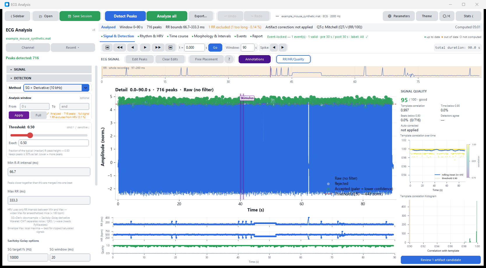

Click **Detect Peaks** to run the selected detection method (**Method**
dropdown in the left sidebar — Auto/NeuroKit2, Savitzky-Golay + derivative,
continuous wavelet transform, envelope-max, or your own trained ML
detector) over the whole recording. The detail plot shows the signal for
the current time window, with accepted peaks marked in green and the
active amplitude threshold as a dashed red line — drag the **Threshold**
slider in the sidebar (or type an exact value) to tighten or loosen
detection without re-running the whole pipeline.

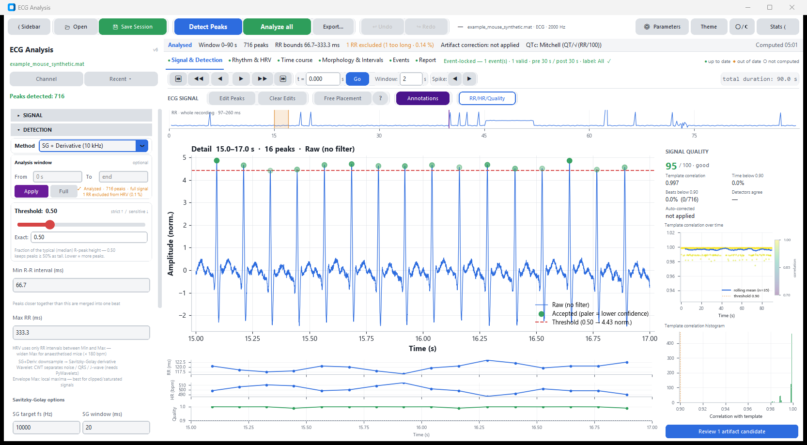

Use the navigation bar above the plot (◀◀ / ◀ / ▶ / ▶▶, or type a time and
click **Go**) to move through the recording, and the **Window** field to
widen or narrow how many seconds are visible at once. If a peak is
missed or a false one is added, **Edit Peaks** switches into manual
edit mode — click near a peak to remove it, or in empty space (with
**Free Placement** on) to add one — with full undo/redo.

The right-hand **Statistics** panel shows heart rate, RR intervals, HRV
(SDNN/RMSSD/pNN6), and a signal-quality score built from how closely
each beat matches the recording's own beat template. Excluding, adding,
or undoing a peak clears the HRV numbers immediately (they'd otherwise
be describing beats that no longer match what's on screen) — click
**Analyze** again to recompute them from the corrected peaks.

---

## Reading the Detection view

The detail plot always shows two traces, layered on top of each other:

- The **primary trace** (solid) — whichever of raw/filtered you have
  selected via the sidebar's "Show raw signal" toggle.
- A **ghost trace** (faint, 20% opacity) — the other one, so the effect
  of filtering is always visible even when you're focused on the raw
  view.

**Blue is raw, purple is filtered** — a fixed color convention across the
whole app, so you can tell at a glance which one you're looking at
without reading the label. Green dots are accepted peaks; a red dashed
line is the active detection threshold.

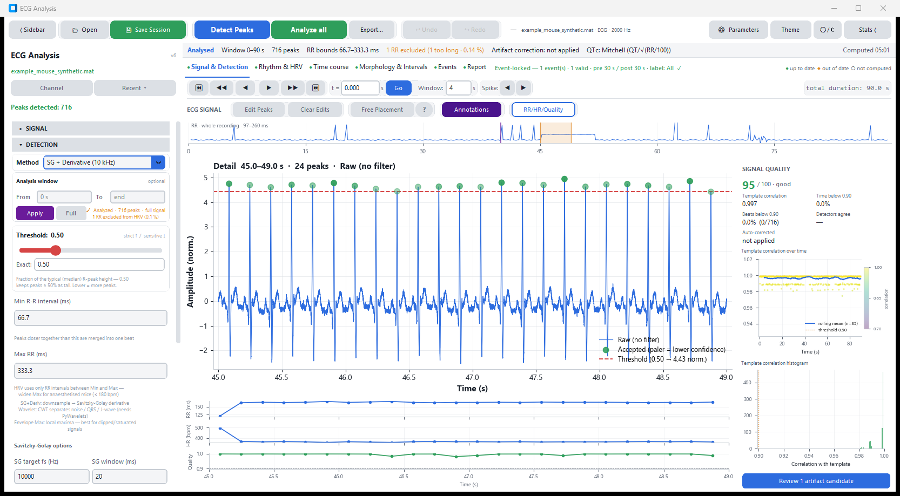

The screenshot above is zoomed into the demo recording's inserted
bradycardia episode — note the visibly wider spacing between peaks
compared to the baseline window shown earlier. This is exactly the kind
of thing the [Abnormal Events](#abnormal-events) tab classifies
automatically across the whole recording, so you don't have to spot it
by scrolling through manually.

---

## HRV analysis

Click **Analyze** (or the per-view buttons described below) to compute
heart-rate variability metrics. The **HRV** tab has seven linked sub-views,
selectable from the row of buttons under the tab bar (the seventh,
**Autonomic**, has a section of its own below).

### RR/HR

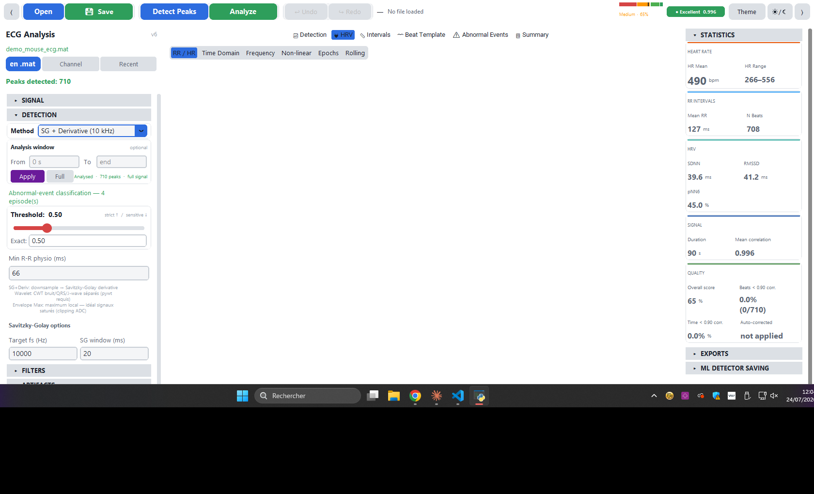

A tachogram of every RR interval and instantaneous heart rate across the
recording, with automatic spike detection (sudden acceleration/
deceleration) and click-to-navigate — click a point here and the
Detection tab jumps straight to that moment.

### Time Domain

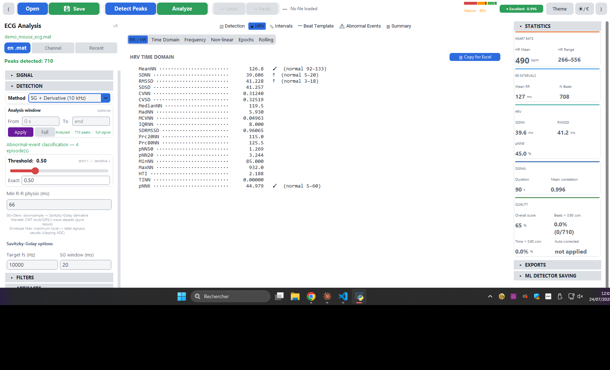

The full time-domain metric set (SDNN, RMSSD, pNN6, SDANN, TINN, HTI...),
without protocol-specific reference-range status markers.

### Frequency

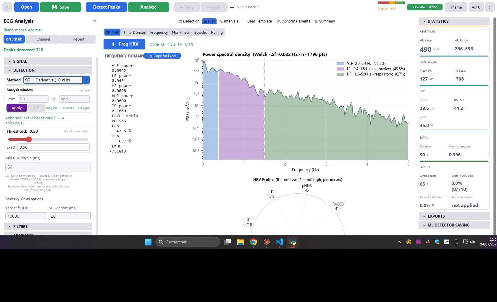

A Welch power spectral density plot with mouse-specific VLF/LF/HF band
shading (not the human 0.04–0.15/0.15–0.4 Hz convention).

### Non-linear

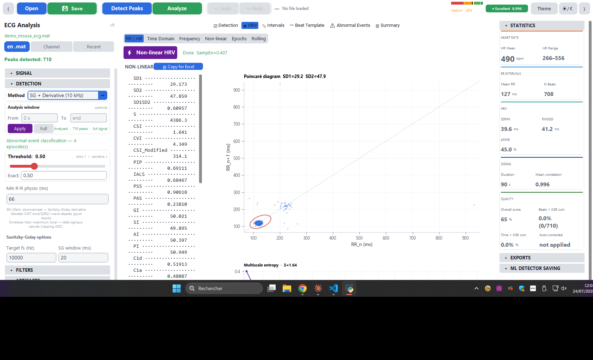

A Poincaré scatter with an SD1/SD2 ellipse overlay, sample entropy, DFA,
and a multiscale entropy (MSEn) curve across coarse-graining scales.

### Epochs

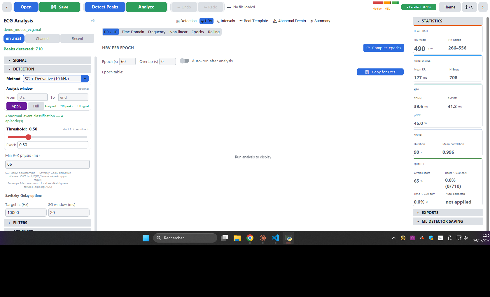

Fixed-window HRV trends, with low-beat-count windows visually flagged so
a noisy stretch doesn't get read as a real physiological change.

### Rolling

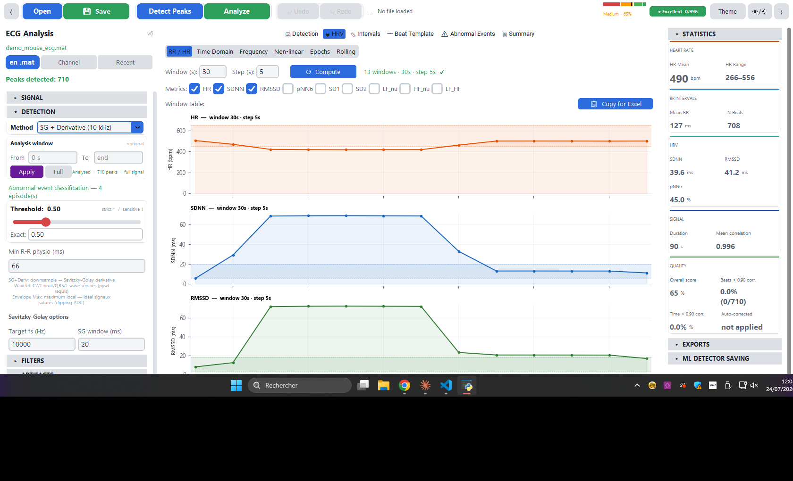

Sliding-window HRV trends with a results table alongside the plot —
useful for watching a metric drift continuously rather than in discrete
epochs. The **Article-style Poincare** options add time-resolved CCD,
SD1 and SD2 using Ledoit–Wolf shrinkage covariance. Set **Window** to 3 s
and **Step** to 1 s to explore the temporal scale used in the rat study;
also compare longer windows, because a 3 s mouse window can contain too
few RR pairs at lower heart rates. Values are only reported when at least
10 consecutive, physiologically valid RR pairs are available in a window.
These Ledoit–Wolf measurements are not the article's CSI / CPI indices and
should not be read as sympathetic or parasympathetic measurements; for the
article's method (one window per beat, CSI / CPI), use the **Autonomic**
view — see
[Autonomic indices](#autonomic-indices-csi--cpi--candia-rivera-et-al-2025).

---

## Autonomic indices (CSI / CPI) — Candia-Rivera et al. 2025

**HRV > Autonomic** computes time-resolved cardiac sympathetic (CSI) and
parasympathetic (CPI) indices after Candia-Rivera et al., J Physiol 2025
([doi:10.1113/JP288400](https://doi.org/10.1113/JP288400)), following the
authors' MATLAB code
([github.com/diegocandiar/robust_hrv](https://github.com/diegocandiar/robust_hrv)).
It needs only the detected peaks — Analyze is not required — and uses the
analysis window, the sidebar **Min / Max RR** bounds and the beats removed
by artifact correction, like every other HRV view. The result records the
analysis window it was computed on: after you change the window, the
status line turns orange ("computed on the analysis window …, now …") until
you press **⟳ Compute** again, and so does a change of the entries (e.g. ks /
kp written by the calibration dialog) that is not applied yet.

### What is computed

For every beat, a sliding Poincaré window of **Window (s)** (3 s, the
paper's rat value) holds the RR intervals that ended in the last *T*
seconds. Its successive pairs give **SD1** / **SD2** (square roots of the
eigenvalues of their covariance) and **D** (CCD — the distance of the
ellipse centre to the origin), time-stamped at the window's median time.
The whole-recording SD01 / SD02 / D0 re-centre the series, which are
resampled at 20 Hz, and

- **CSI = D̃ + ks · SD2** — D̃ is D mirrored about its mean, so a shorter
  cycle raises CSI;
- **CPI = D + kp · SD1** — a longer cycle raises CPI.

(The paper's printed equations put the mirrored D on CPI; its code mirrors
it for CSI, as the physiology requires — the app follows the code.)

Excluded RR intervals (outside the bounds, or spanning a removed beat) are
never bridged: Poincaré pairs never straddle them, and a window with fewer
than **Min pairs** valid adjacent pairs (10 by default) is withheld — blank,
and shaded grey on the plot. That floor is the app's addition: the
reference code computes every window, and **Min pairs = 2** reproduces it.
At 3 s, a window holds 10 pairs only above ~200 bpm: for bradycardic or
anaesthetised mice, lower Min pairs or lengthen the window.

### Choosing the covariance method

The **Method** dropdown sets how SD1 / SD2 (and D) are estimated:

- **Robust shrinkage** (default) — Schäfer & Strimmer (2005) shrinkage
  (`robustCovHRV.m`: variances toward their median, correlation toward 0),
  5 % trimmed-mean D. This is what the paper **text** says was used.
- **Rat reference code** — plain covariance with 5 % trimmed-mean D. This
  is what the published rat function `compute_CSI_CVI_rat.m` actually runs
  (its call to the robust estimator is commented out). The paper and its
  code therefore disagree; both are offered and the one used is recorded
  with every result and export.
- **Exact** / **Approximate** — the two other variants of
  `compute_rCSI_rCVI_type.m` (plain covariance; closed-form SD1 / SD2).
- **Ledoit–Wolf** — sklearn shrinkage toward a scaled identity, the
  estimator of the Rolling view's SD1 (LW) / SD2 (LW); for comparison
  only. Relative to the exact covariance it typically raises SD1 by 3–12 %
  and lowers SD2 by 4–10 % on 25–35-pair windows (data-dependent; it can
  lower SD1 in some windows). The robust shrinkage rounds the ellipse
  less (SD1 +4 to +7 %, SD2 −1 to −5 % on ~25-pair synthetic mouse
  windows) and in every window raises SD1 and lowers SD2.

### The ks / kp caveat

**ks = 3 and kp = 12 are the paper's rat (SHR) values** — rest vs
dobutamine, chosen at the inflection point of the paired Wilcoxon Z over
k = 1–20 and checked on WKY rats. **They are not validated in mice.** The
orange note under the controls, the plot title, the recording-level table
and every export (Excel Cover sheet, Prism notes, PDF header) say so.
Calibrate them on your cohort (see *Calibrating ks / kp* below).

### LF / HF (SPWVD)

Tick **LF/HF (SPWVD)** before **⟳ Compute** to add a fifth panel with
time-resolved LF and HF power from the smoothed pseudo Wigner–Ville
distribution (a port of `compute_PWVD.m`, Orini et al. 2012 kernel): RR
spline-resampled at 20 Hz, LF / HF summed over the HRV band preset (mouse
default LF 0.4–1.5 Hz, HF 1.5–5 Hz; the paper's rat bands were 0.1–1 /
1–3.5 Hz). The kernel constants ν₀ = 0.03, τ₀ = 0.06, λ = 0.3 are the ones
hard-coded in `compute_PWVD.m` — the toolbox's only set (its file defaults
are Frr = 4 Hz and the human bands); the paper applied them at 20 Hz to
rats. They are defined in normalised units, so their extent in seconds
and Hz depends on the 20 Hz resampling and the 4096 bins; they are not
validated in mice. It runs in overlapping chunks (120 s cores, 60 s
margins; about 40 s per hour of recording; 30 s post / pre ratios within
~0.1–1 % of a single pass). The power is unnormalised (a.u.) — compare it
within a recording, not with the Frequency view's Welch powers. RR gaps
longer than 2 s split the series: each stretch between them is computed as
its own series (the reference code bridges everything), the gaps are
blank, and so are stretches shorter than 10 s (two periods of the 0.4 Hz
LF floor, the ~12 s lag kernel). Shorter gaps are bridged; if they cover
more than 5 % of the time, LF / HF is not computed (the status says why)
and CSI / CPI are still shown.

### Event-locked workflow

Switch the view's toggle from **Time series** to **Event-locked**.

1. **Mark the events.** Add one annotation per condition change (injection,
   stimulus…) in **Annotations**; its **start** time is the event onset.
   Give events of the same kind the same label.
2. **Compute the Autonomic indices** (⟳ Compute in the bar above).
3. **Choose the events and windows.** **Events** = *All*, one label, or
   *(unlabelled)*; **Pre** / **Post** = the windows before and after each
   onset (30 s / 30 s, as in the paper).
4. **⟳ Compute event-locked.** The plot shows CSI, CPI, HR (and LF / HF)
   around the onset (vertical line at 0): the bold line is the median
   across this recording's events, the shaded band ± the median absolute
   deviation, the faint lines the individual events. **z-score (display)**
   normalises each series by its whole-recording mean and SD, as in the
   paper's figures; it changes the plot only. The table under it lists, per
   event, the pre and post means and their delta for HR, D, SD1, SD2, CSI,
   CPI (and LF / HF); **📋 Copy for Excel** copies one row per event. An
   event is **valid** when **no other annotation starts inside its pre or
   post window or at its onset** (the paper's minimum duration per
   condition; every annotation counts, also those the Events filter leaves
   out), and both windows lie inside the CSI / CPI series and are at least
   80 % covered by computed windows. **Events closer than Pre / Post to
   another event are INVALID** — successive doses would otherwise
   contaminate each other's baseline and response — and so are events too
   close to the start or end of the recording or over withheld stretches;
   the table says why, and invalid events are left out. HR and LF / HF are
   judged on their own coverage.
5. **Read the within-recording Wilcoxon with care.** It compares pre vs
   post over the events of *this* recording only: the events of one animal
   are repeated measures of that animal, so its p-values are descriptive,
   not population inference. **p** is the test's p (exact for small
   samples), **p(z)** the normal p of the z shown (MATLAB `signrank`'s
   approximate p); near 0.05 they can disagree.
6. **💾 Save to cohort registry.** Fill in the sidebar **Subject ID** and
   **Project name** first: they are stored with every event, together with
   the method, window, ks, kp and pre / post windows. **Set the Subject ID
   for each animal**: the sidebar keeps its value from one file to the
   next, and the per-subject calibration counts every recording filed
   under one ID as one animal. The status turns orange when the ID looks
   like the untouched default (`subject_01`) or when another recording of
   the project is already saved under it. Saving with the *All* filter
   replaces this recording's previously saved events of the same method
   and window (so a deleted annotation does not linger); saving one label
   only adds or updates that label's events. The status bar confirms how
   many events were written. **Export CSV…** saves the same rows to a
   file.

Changing the annotations, the peaks or the Autonomic parameters drops the
event-locked result (the panel says why); compute it again.

### Calibrating ks / kp

Once several animals are in the registry, click **⚖ Calibrate ks/kp…**:

1. Filter by **Label** (the contrast to calibrate on, e.g. the drug) and
   **Project** (pre-filled with the current project; empty = all), then
   choose the **Configuration** (method · window) — events computed with
   different methods or windows are never mixed. The dialog opens on the
   label with the most events: one condition contrast, as the paper's
   rest vs dobutamine. **All labels** pools different contrasts (vehicle
   and drug, two drugs) into one pre / post pair per animal; the dialog
   says so and Apply asks for confirmation.
2. Keep **Per subject mean** (default): each animal's events are averaged
   first, so an animal with five injections does not weigh five times —
   testing events as independent samples is pseudo-replication. Events
   without a Subject ID are treated as one subject per recording, and
   recordings sharing a default-looking ID are flagged. **Per event**
   reproduces the paper's procedure (it computed Z over trials: 41 SHR
   trials); per subject mean is this app's stricter default. The counts
   line shows n events, n subjects and n recordings.
3. Read the two **Z(k)** curves (k = 1–20): the paired Wilcoxon Z of
   post vs pre for CSI (−ΔD + ks·ΔSD2) and CPI (ΔD + kp·ΔSD1). Because the
   indices are linear in k, these come straight from the stored deltas of
   D, SD1 and SD2 — no recording is reprocessed. The paper's rule is the
   **inflection point** from which Z plateaus; the star marks a knee
   computed as an objective proxy (Kneedle on Z after its last sign
   change). Check that it sits where the curve flattens; dotted grey lines
   mark the rat values, dashed blue lines the current gains, dotted
   horizontal lines |Z| = 1.96 and dash-dot lines the Wilcoxon ceiling.
   Three things to watch, all spelled out under the curves:
   - **The ceiling.** Z is a rank statistic: it moves in discrete steps and
     cannot exceed a ceiling set by the number of units (2.20 for 6,
     2.52 for 8, 3.06 for 12). On that ceiling every animal changes the
     same way and Z cannot rank the gains; no knee is offered when the
     curve moves by fewer than 3 rank steps.
   - **A sign change.** When the heart-rate and HRV terms move in opposite
     directions, Z(k) changes sign: the index shows one direction at small
     k and the opposite at large k (the reversed stretch is shaded). A knee
     on the reversed stretch is marked ⚠ — choose the gain by the
     direction the physiology predicts (a sympathomimetic should raise
     CSI).
   - **In-sample tests.** The tests at gains chosen on these same events
     are optimistic (choosing k among 20 values is a selection the ×2
     Bonferroni does not correct; the paper validated its gains on another
     strain). They are marked *in-sample*: calibrate on one project or
     label, then select another to test at those gains.
4. The table gives, **at the current gains**, the paired Wilcoxon of CSI
   and CPI: n, median ± MAD before and after, z, p, p(z) and p
   Bonferroni-corrected for the two indices. With fewer than 6 subjects
   the exact two-sided p cannot reach 0.05.
5. **Apply ks = …, kp = …** writes the knee values into the Autonomic
   view's ks / kp entries (a gain with no knee is kept); it first asks for
   confirmation when a knee lies on a reversed stretch or labels are
   pooled. **It does not recompute anything**: press **⟳ Compute**, then
   **⟳ Compute event-locked**, to see the indices with the new gains (until
   then the Autonomic status says the entries differ from the displayed
   result). Report the gains together with the cohort they were calibrated
   on.

**Copy results** puts the test table on the clipboard; **Export cohort
CSV…** writes the filtered registry rows.

### Exports

With an Autonomic result, **Export Excel** adds the **Autonomic** sheet
(beat-wise SD1 / SD2 / CCD windows, recording-level SD01 / SD02 / D0 and
every parameter), **Autonomic_Series** (20 Hz CSI / CPI / HR / D / SD1 /
SD2), **Autonomic_LFHF** and **EventLocked**; **Export Prism** adds CSI /
CPI, D / SD1 / SD2, LF / HF and per-event pre / post tables; the figure and
ZIP exports include the Autonomic and Event-locked plots. The Excel Cover
sheet, the Prism project notes and the PDF report header state the method,
window, ks / kp and the rat-calibration caveat, and the span the indices
cover (first / last R peak and analysis window) — flagged when it is not
the window of the core HRV results in the same file. Since the Autonomic
view needs only the peaks, **Export Excel** also works before Analyze: it
then writes the Autonomic results alone (a Cover sheet saying the core HRV
was not computed, and the Autonomic sheets). The ZIP, Prism, PDF and
figure exports need Analyze.

### References

- Candia-Rivera D. et al. (2025). Modelling the time-resolved modulations
  of cardiac activity in rats: a study on pharmacological autonomic
  stimulation. *J Physiol*. [doi:10.1113/JP288400](https://doi.org/10.1113/JP288400)
- Candia-Rivera D., de Vico Fallani F., Chavez M. (2025). Robust and
  time-resolved estimation of cardiac sympathetic and parasympathetic
  indices. *R Soc Open Sci* 12:240750.
  [doi:10.1098/rsos.240750](https://doi.org/10.1098/rsos.240750)
- Code: [github.com/diegocandiar/robust_hrv](https://github.com/diegocandiar/robust_hrv)
- Schäfer J., Strimmer K. (2005). A shrinkage approach to large-scale
  covariance matrix estimation and implications for functional genomics.
  *Stat Appl Genet Mol Biol* 4:32.
- Orini M. et al. (2012). Characterization of dynamic interactions between
  cardiovascular signals by time-frequency coherence. *IEEE Trans Biomed
  Eng* 59(3):663–673.

---

## Interval delineation

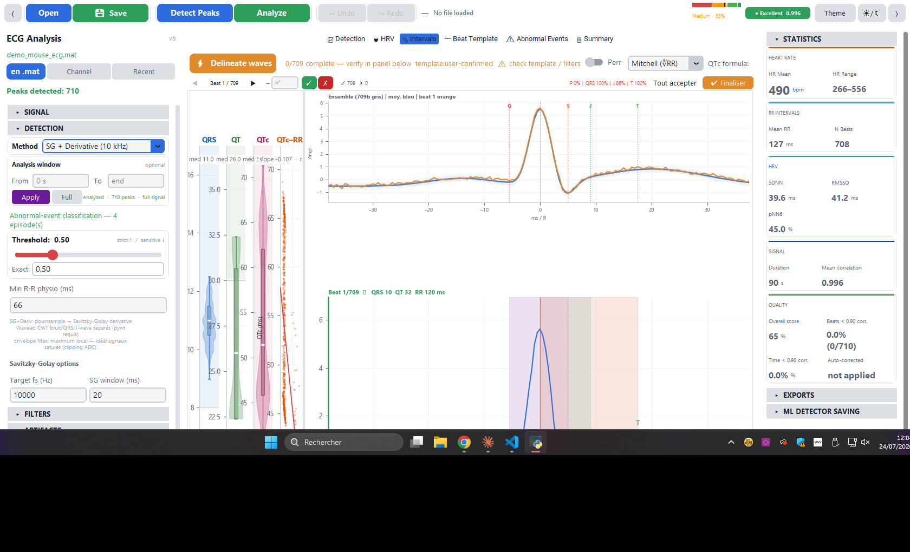

Click **Delineate Waves** to locate P/Q/R/S/J/T landmarks on every beat
and compute PR/QRS/QT/QTc intervals. The panel on the left is a beat
verifier — step through individual beats (or the ensemble average) and
correct the template if the automatic landmark placement looks wrong
before trusting the QT/QTc numbers. The **QTc formula** dropdown switches
between (RR in ms):

- **Mitchell** (default, mouse-calibrated) — QTc = QT / √(RR / 100), Bazett
  normalised to a 100 ms mouse RR;
- **Bazett** (human) — QTc = QT / √(RR / 1000);
- **Fridericia** (human) — QTc = QT / ∛(RR / 1000).

Bazett and Fridericia are calibrated for a 1 s human RR and inflate QTc
~2–3.5× at mouse heart rates — use them only to compare with studies that
report them. The distribution plots on the right update immediately; check
the **QTc–RR** panel (a well-corrected QTc shows no slope against RR) rather
than trusting one formula's number blindly. Because the QT–RR relation is
weak in mice, always report the **uncorrected QT** alongside QTc. The formula
in use is recorded in the Excel, Prism and PDF exports, and saved with the
session.

---

## Abnormal events

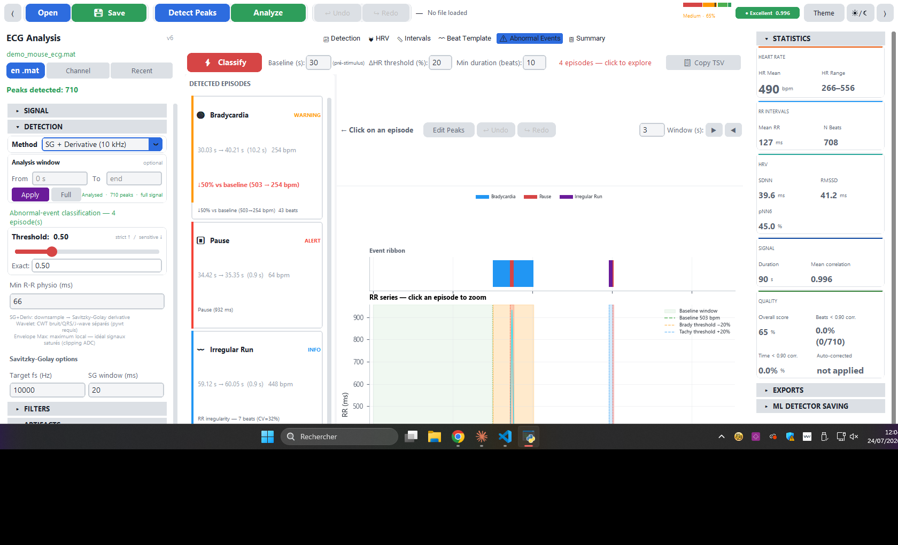

Click **Classify** to detect bradycardia/tachycardia runs, pauses,
ectopic-beat runs, irregular-rhythm runs, and AV conduction-delay
episodes — all measured against this recording's own baseline heart
rate, not a fixed cutoff. The color-coded ribbon at the top gives an
at-a-glance view of where events cluster; each card on the left is one
episode. Click a card (or a ribbon segment) to zoom the RR-series plot
straight to that episode — in the screenshot above, the demo recording's
inserted bradycardia, pause, and irregular run were all found and are
listed with their exact timing and severity.

**Baseline (s)**, **ΔHR threshold (%)**, and **Min duration (beats)** at
the top control sensitivity — widen the baseline window or loosen the
threshold if real events are being missed, or tighten them if normal
variability is being over-flagged.

---

## Summary tab

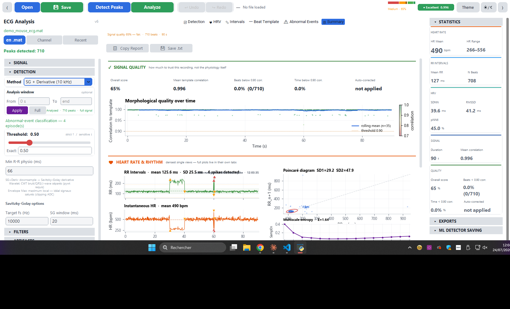

A single-page rollup of everything computed so far: signal quality over
time, RR intervals with spikes marked, instantaneous HR, the Poincaré
diagram, and the multiscale entropy curve — plus **Copy Report** and
**Save .txt** to get a plain-text version for a lab notebook or a quick
message to a colleague, without needing the full PDF/Excel export.

---

## Parameters & interpretation

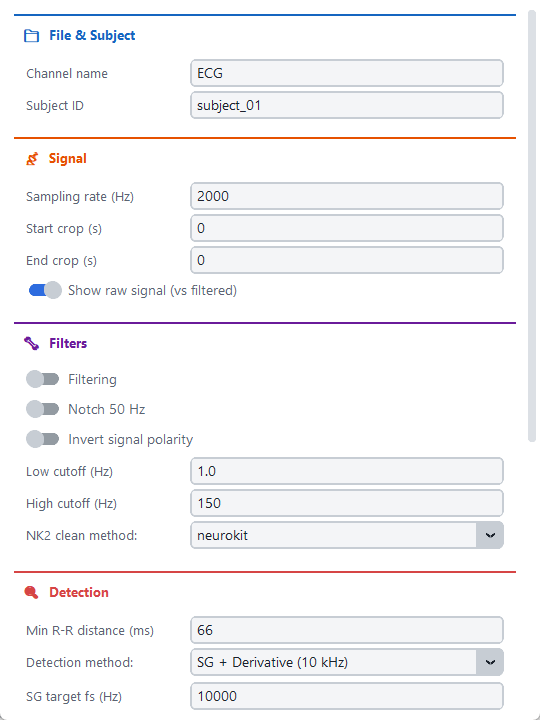

Open **⚙ Parameters** (top toolbar, right side) for every setting that
affects analysis: channel/subject metadata, sampling rate override,
filter cutoffs, and detection thresholds. Metrics use mouse-calibrated
algorithms, but protocol-specific reference ranges are not currently
selectable in the application. Interpret results using validated reference
data for your strain and experimental conditions.

---

## Exporting & saving your work

- **Save Session** (toolbar, or `Ctrl+S`) writes a `.ecgsession` file with
  every result computed so far, so reopening it later restores the exact
  state — no need to re-run detection or analysis.
- The **EXPORTS** section (right panel — it opens automatically the first
  time an analysis finishes) covers everything else: a formatted Excel
  workbook, GraphPad Prism `.pzfx`, a one-page PDF report (signal strip,
  key metrics, Poincaré diagram, abnormal-events summary), a
  per-episode annotated PDF for abnormal events, and CSV. HRV > Autonomic
  results add their own Excel sheets and Prism tables (see
  [Exports](#exports) in the Autonomic section).
- **💾 Save to cohort registry** (HRV > Autonomic > Event-locked) keeps
  each recording's per-event autonomic results in the local registry, for
  the cohort calibration of ks / kp.
- If you're building a training set for the ML R-peak detector, **Save
  for Training** (right panel, ML Detector Saving section) caches this
  recording's corrected peaks without needing a full session save.

---

## Tips & troubleshooting

- **The trace looks flipped/upside-down where you didn't expect it** —
  the detection pipeline includes an automatic polarity-correction vote
  when filtering is enabled, so it can re-orient the signal for
  detection accuracy. If you specifically want the signal left exactly
  as loaded, turn **Filtering** off (the default) rather than on — raw/
  no-filter mode always leaves polarity untouched.
- **A window/dialog seems to freeze on close** — give background
  operations (Detect Peaks, Analyze, Classify) a moment to finish; the
  toolbar's progress bar and ETA readout show whether something is still
  running.
- **A metric needs a protocol-specific reference range** — the application
  does not currently grade results against selectable experimental contexts;
  compare with validated data appropriate to your strain and protocol.
- **Automated tests do not cover the full GUI** — if something looks
  wrong after an update, cross-check the affected tab's numbers against
  the Summary tab or a known-good session file before trusting a new
  result.
